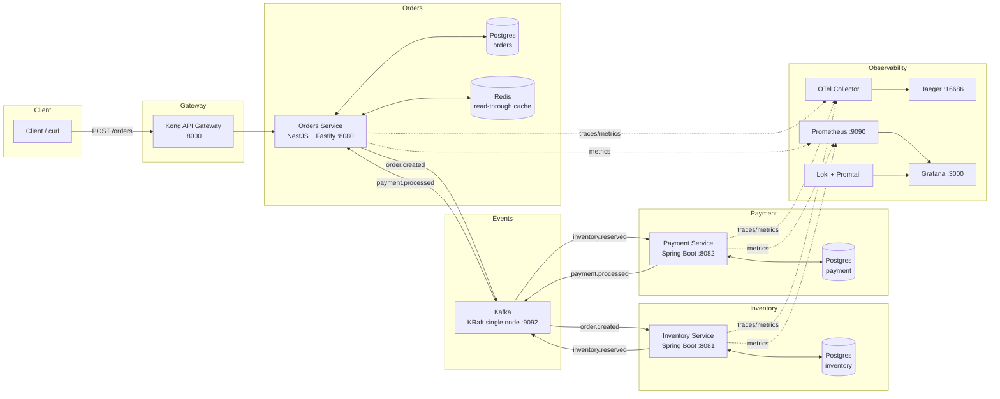
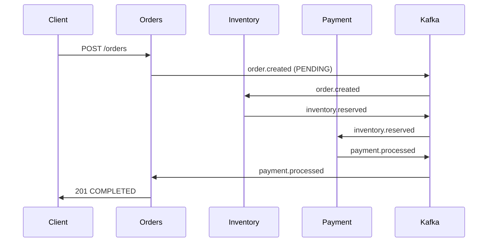

# Choreography Saga Pattern

A cloud-native **choreographed saga** microservices platform for order processing, built as a reference implementation of distributed transactions without a central orchestrator. Each service reacts to domain events published on Kafka and emits the next event — or a compensation event that unwinds the saga when something fails.

## Architecture



### Saga flow (happy path)



### Compensation paths

- **Out of stock** → inventory emits `inventory.reservation-failed` → order becomes **CANCELLED**.
- **Payment failure** (or `?simulate=payment_failure`) → payment emits `payment.failed` → order becomes **CANCELLED**, and `order.cancelled` is emitted → inventory **releases** the reserved stock.

## Services

| Service | Tech | Port | Database | Role |
| --- | --- | --- | --- | --- |
| orders-service | NestJS 11 + Fastify (Node 24) | 8080 | orders | Saga entry point, orchestration-free state machine |
| inventory-service | Spring Boot 4.1 + Java 25 | 8081 | inventory | Reserves/releases stock, emits reservation events |
| payment-service | Spring Boot 4.1 + Java 25 | 8082 | payment | Processes payments, emits processed/failed events |

## Reliability patterns

- **Transactional outbox** — events are written to an `outbox` table in the same transaction as the business change; a poller forwards them to Kafka (at-least-once delivery).
- **Inbox / idempotent consumers** — each consumer deduplicates by event id in an `inbox_events` table, making re-deliveries safe.
- **Read-through cache** — orders-service caches order lookups in Redis (TTL 60s).

## Getting started

### Prerequisites

- Docker + Docker Compose plugin
- Node.js 24 and npm (for local orders-service dev)
- JDK 25 and Gradle (for local Java service dev)

### Run the stack

```bash
./scripts/dev.sh up
```

The `up` command builds and starts the entire stack (Kafka, Postgres, Redis, Kong, Jaeger, Prometheus, Loki, Grafana, and the three services) and waits for readiness.

### Useful commands

| Command | Description |
| --- | --- |
| `./scripts/dev.sh up` | Build and start the full stack |
| `./scripts/dev.sh down` | Stop and remove containers |
| `./scripts/dev.sh logs` | Tail logs for all services |
| `./scripts/dev.sh ps` | Show container status |
| `./scripts/dev.sh seed` | Seed stock for the sample SKUs |
| `./scripts/dev.sh e2e` | Run the Python e2e test suite |
| `./scripts/dev.sh test` | Run unit builds/tests for all services |
| `./scripts/dev.sh help` | Show all commands |

## Try it

Create an order (happy path):

```bash
curl -s -X POST http://localhost:8000/orders \
  -H 'Content-Type: application/json' \
  -d '{"customerId":"c-1","items":[{"sku":"sku-1","quantity":2}],"totalAmount":99.90,"currency":"USD"}'
```

Simulate an inventory failure (order ends up CANCELLED):

```bash
curl -s -X POST http://localhost:8000/orders \
  -H 'Content-Type: application/json' \
  -d '{"customerId":"c-1","items":[{"sku":"sku-1","quantity":2}],"totalAmount":99.90,"currency":"USD","simulate":"inventory_failure"}'
```

Simulate a payment failure (payment emits `payment.failed`, order CANCELLED, stock released):

```bash
curl -s -X POST http://localhost:8000/orders \
  -H 'Content-Type: application/json' \
  -d '{"customerId":"c-1","items":[{"sku":"sku-1","quantity":2}],"totalAmount":99.90,"currency":"USD","simulate":"payment_failure"}'
```

Inspect an order's status:

```bash
curl -s http://localhost:8000/orders/<ORDER_ID>
```

## Port map

| Port | Service |
| --- | --- |
| 8000 | Kong API Gateway (orders routes) |
| 8080 | orders-service (NestJS/Fastify) |
| 8081 | inventory-service (Spring Boot) |
| 8082 | payment-service (Spring Boot) |
| 9092 | Kafka broker |
| 5432 | Postgres |
| 6379 | Redis |
| 16686 | Jaeger UI |
| 9090 | Prometheus |
| 3000 | Grafana (admin/admin) |
| 3100 | Loki |

## Observability

- **Traces** — Jaeger at http://localhost:16686 (spans propagated across HTTP and Kafka hops)
- **Metrics** — Prometheus at http://localhost:9090, dashboards in Grafana at http://localhost:3000 (login `admin` / `admin`)
- **Logs** — Loki (queried from Grafana's Explore)

## E2E tests

Black-box tests in `e2e/` (Python + `pytest`) validate the happy path and both compensation flows against the running stack:

```bash
./scripts/dev.sh e2e
```

## Project layout

```
├── docker-compose.yml
├── scripts/dev.sh
├── docs/events.md            # event contracts & topics
├── infra/                    # kafka, kong, postgres, otel, prometheus, loki, grafana
├── services/
│   ├── orders-service/       # NestJS + Fastify
│   ├── inventory-service/    # Spring Boot
│   └── payment-service/      # Spring Boot
└── e2e/                      # Python pytest suite
```
