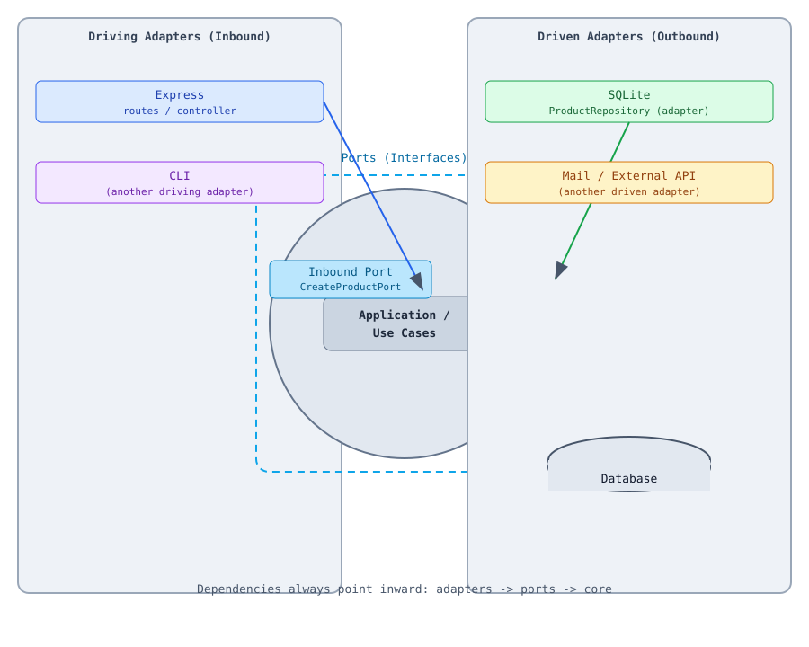

# Hexagonal Architecture (Ports and Adapters)

## How run

- `npm install` install all the dependencies
- `npm test` run all unit tests
- `npm start` run the HTTP server (Express)

## Annotations



## Structure

```
src/
├── core/                                        # innermost layer (no external dependencies)
│   ├── domain/                                  # business rules
│   │   └── product.ts
│   └── application/
│       ├── use-cases/                           # application services
│       │   └── create-product.use-case.ts
│       └── ports/
│           ├── inbound/                         # driving ports (interfaces)
│           │   └── create-product.port.ts
│           └── outbound/                        # driven ports (interfaces)
│               └── product.repository.port.ts
├── adapters/                                    # outer layer (implements the ports)
│   ├── inbound/                                 # driving adapters
│   │   └── http/express/                        # Express controller/routes
│   └── outbound/                                # driven adapters
│       └── persistence/sqlite/                  # Sequelize repository/model
├── config/
│   └── database.ts
└── main/
    └── server.ts                                # composition root
```

## Flow

```
HTTP (driving adapter)
    -> CreateProductPort (driving port)
        -> CreateProductUseCase (core/application)
            -> ProductRepositoryPort (driven port)
                -> ProductRepository (driven adapter)
                    -> SQLite
```

The core does not know about Express or Sequelize. Adapters change
(HTTP -> CLI, SQLite -> PostgreSQL) without touching the domain.