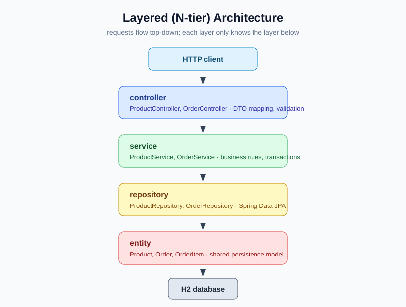

# Layered Architecture POC

A small e-commerce example (products + orders) built with the **classic layered
(N-tier) architecture**: code is organized by *technical layer*, and requests flow
top-down through controller → service → repository → database.

- Java 25
- Spring Boot 4.1.0
- Spring Web (REST), Spring Data JPA, Bean Validation, Actuator
- H2 in-memory database (seeded on startup)
- Gradle Kotlin DSL
- Checkstyle (Google checks)

## Layering



```
        HTTP
         │
 ┌───────▼─────────┐
 │  controller     │  @RestController, request/response mapping, validation
 ├───────▼─────────┤
 │  service        │  business rules, transactions
 ├───────▼─────────┤
 │  repository     │  Spring Data JPA interfaces
 ├───────▼─────────┤
 │  entity         │  JPA entities (persistence model)
 └───────▼─────────┘
        H2
```

Supporting packages: `dto` (request/response records), `exception`
(domain exceptions + `@RestControllerAdvice`).

Dependency direction is strict and one-way: `controller → service → repository`,
with entities shared across layers. This is intentional for a layered POC — the
trade-off is that layers are coupled to the persistence model and there is no
enforced boundary between business capabilities.

The dependency rules are enforced by an [ArchUnit](https://www.archunit.org/) test
(`LayeredArchitectureTest`), so a regression that, for example, calls a repository
from a controller fails the build.

### Package layout

```
com.poc.layered
├── controller   ProductController, OrderController
├── service      ProductService, OrderService
├── repository   ProductRepository, OrderRepository
├── entity       Product, Order, OrderItem
├── dto          request/response records
└── exception    NotFoundException, GlobalExceptionHandler
```

## Run

```bash
./gradlew bootRun
```

Application starts on <http://localhost:8080>.

## Build / test

```bash
./gradlew build
```

Runs compilation, Checkstyle (main + test) and the test suite. Tests:

- `ProductServiceTest` — unit tests with Mockito (create, update, delete, not-found).
- `OrderFlowIntegrationTest` — full-context REST test (place order, verify stock decrement, validation).
- `ProductLifecycleIntegrationTest` — full-context REST test for update/delete.
- `LayeredArchitectureTest` — ArchUnit rules enforcing the one-way layer dependencies.

## API

| Method | Path                 | Description                          |
| ------ | -------------------- | ------------------------------------ |
| POST   | `/api/products`      | Create a product                     |
| GET    | `/api/products`      | List products                        |
| GET    | `/api/products/{id}` | Get a product                        |
| PUT    | `/api/products/{id}` | Replace a product                    |
| DELETE | `/api/products/{id}` | Delete a product                     |
| POST   | `/api/orders`        | Place an order (decrements stock)    |
| GET    | `/api/orders`        | List orders                          |
| GET    | `/api/orders/{id}`   | Get an order                         |
| GET    | `/actuator/health`   | Health check                         |

### Examples

```bash
curl -X POST http://localhost:8080/api/orders \
  -H 'Content-Type: application/json' \
  -d '{"customerName":"Alice","items":[{"productId":1,"quantity":2}]}'

curl -X PUT http://localhost:8080/api/products/1 \
  -H 'Content-Type: application/json' \
  -d '{"sku":"SKU-001","name":"Mechanical Keyboard","price":129.00,"stock":40}'

curl -X DELETE http://localhost:8080/api/products/1
```
