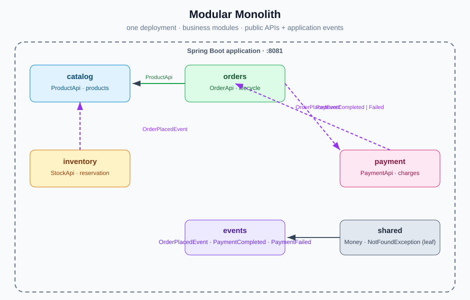

# Modular Monolith POC

A small e-commerce example (catalog, inventory, orders, payments) built as a
**modular monolith**: one deployable Spring Boot application, but code is
grouped into independent *business modules* instead of technical layers. Modules
communicate through explicit public APIs and application events, and the module
boundaries are verified by [Spring Modulith](https://spring.io/projects/spring-modulith).

- Java 25
- Spring Boot 4.1.0
- Spring Modulith 2.1.1 (module boundaries, event publication, `ApplicationModuleTest`)
- Spring Web, Spring Data JPA, Bean Validation, Actuator
- H2 in-memory database (seeded on startup)
- Gradle Kotlin DSL
- Checkstyle (Google checks)

## Modules

```
com.poc.modular
├── catalog     product catalog (ProductApi)
├── inventory   stock reservation (StockApi)
├── orders      order lifecycle (OrderApi)
├── payment     payment processing (PaymentApi)
├── events      cross-module application events
└── shared      shared kernel: Money, NotFoundException
```

Each business module is a *closed* package: the module's public types live in
the root package (e.g. `com.poc.modular.catalog.ProductApi`) and its internals
live in `*.internal`. Other modules may only depend on the public API — an
illegal dependency on an internal type fails `ModularityTests` (and the Spring
Modulith verifier).

### Module dependencies

```
        ┌──────────────────────────────────────┐
        │            events                    │
        │  OrderPlacedEvent · PaymentCompleted │
        │  · PaymentFailed                     │
        └──────────────┬───────────────────────┘
                       │ (depends on shared)
        ┌──────────────▼────────────┐
        │           shared          │  Money, NotFoundException (leaf)
        └───────────────────────────┘
```

- `orders   → catalog, events, shared`
- `inventory → events, shared`
- `payment  → events, shared`
- `catalog  → shared`
- `events   → shared`

There are no cyclic module dependencies. The shared kernel (`Money`,
`NotFoundException`) is a leaf that everything may depend on.

## Interaction flow (event-driven)



When an order is placed, `orders` publishes an `OrderPlacedEvent`; `inventory`
and `payment` react asynchronously:

```
POST /api/orders
   │  (orders) publishes OrderPlacedEvent ───────────────┐
   ▼                                                     ▼
 inventory reserves stock                     payment charges card
                                              │
                                     publishes PaymentCompletedEvent
                                              │
                                              ▼
                                   (orders) order → CONFIRMED
                                          PaymentFailedEvent → CANCELLED
```

Events are defined in the `events` module so producers and consumers can
communicate without introducing module cycles. The event publication is backed
by Spring Modulith's JDBC registry (outbox-style), which persists publications
and provides at-least-once delivery.

## Features

- Products: create, list, get, set stock, reserve stock on order placement.
- Orders: place (totals from catalog), list, get, and status transitions driven
  by async events (`PLACED → CONFIRMED | CANCELLED`).
- Payments: charges created from the order total, retrievable per order.
- Boundary enforcement via Spring Modulith `verify()` plus an explicit
  module-set assertion.
- `ApplicationModuleTest` scenario tests exercise event delivery.

## Run

```bash
./gradlew bootRun
```

Application starts on <http://localhost:8081>.

## Build / test

```bash
./gradlew build
```

Runs compilation, Checkstyle (main + test) and the test suite. Tests:

- `ModularityTests` — Spring Modulith `verify()` (boundaries) + module set.
- `OrderFlowIntegrationTest` — full-context REST flow: place order, await stock
  decrement and order `CONFIRMED`, verify the payment record.
- `InventoryReservationTest` — module scenario test: publishing `OrderPlacedEvent`
  reserves stock.
- `OrderPaymentListenerTest` — module scenario test: `PaymentFailedEvent`
  cancels the order.

## API

| Method | Path                        | Description                        |
| ------ | --------------------------- | ---------------------------------- |
| POST   | `/api/products`             | Create a product                   |
| GET    | `/api/products`             | List products                      |
| GET    | `/api/products/{id}`        | Get a product                      |
| POST   | `/api/orders`               | Place an order (async stock + payment) |
| GET    | `/api/orders`               | List orders                        |
| GET    | `/api/orders/{id}`          | Get an order (status transitions)  |
| GET    | `/api/stock/{productId}`    | Available stock                    |
| PUT    | `/api/stock/{productId}`    | Set stock                          |
| GET    | `/api/payments/order/{orderId}` | Get the payment for an order    |
| GET    | `/actuator/health`          | Health check                       |

### Examples

```bash
# Place an order; stock is reserved and the order becomes CONFIRMED shortly after
curl -X POST http://localhost:8081/api/orders \
  -H 'Content-Type: application/json' \
  -d '{"customerName":"Alice","items":[{"productId":1,"quantity":2}]}'

# Inspect the resulting payment
curl http://localhost:8081/api/payments/order/1
```