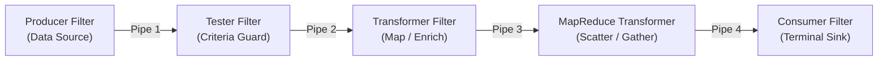
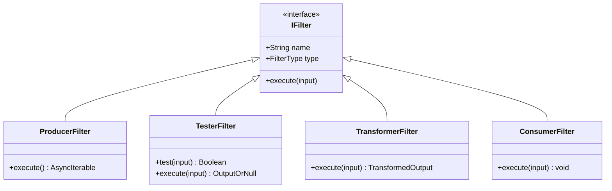
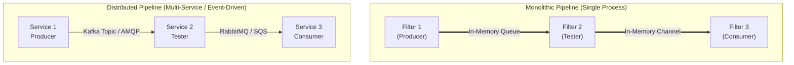
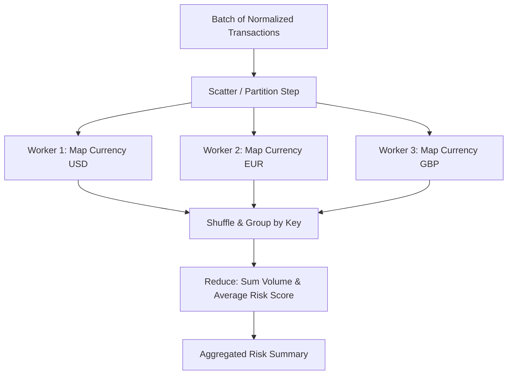

# Pipeline Architecture Style: In-Depth Architecture Specification

> References: Mark Richards & Neal Ford, *Fundamentals of Software Architecture* (O'Reilly).

---

## 1. Pipeline Topology & Fundamentals

The **Pipeline Architecture Style** (also known as **Pipes and Filters**) is an architectural pattern that structures execution around unidirectional data processing.

### 1.1 Pipes
- **Unidirectional & Point-to-Point**: A pipe accepts input from exactly one upstream filter and sends output to exactly one downstream filter.
- **Decoupled Contracts**: Filters know nothing about upstream or downstream stages. They communicate only through the data format delivered by the pipe.
- **Buffering & Backpressure**: Pipes can be unbuffered (direct method call), buffered (FIFO queue), or streaming (reactive stream with backpressure).

### 1.2 Filters
Filters are self-contained, discrete, and stateless processing units.

---

## 2. Monolithic vs. Distributed Deployment Models

A primary focus in Richards & Ford's analysis is the contrast between **monolithic** and **distributed** pipeline implementations.

### Comparison Matrix

| Dimension | Monolithic Pipeline | Distributed Pipeline |
| :--- | :--- | :--- |
| **Typical Deployment** | Single OS process, container, or JVM | Microservices, AWS Lambda, Kubernetes pods |
| **Pipes Mechanism** | Async queues, reactive streams, channels | Kafka topics, RabbitMQ queues, gRPC streams |
| **Latency** | Sub-millisecond (in-memory pointer exchange) | Network latency per hop (5-50ms+) |
| **Data Serialization** | Zero serialization (passes live objects) | JSON, Protobuf, Avro overhead |
| **Elasticity** | Scales entire process as one unit | Filters scale independently based on load |
| **Reliability** | Process crash aborts pipeline | Durable queues allow retries and dead-lettering |
| **Failure Handling** | In-process try/catch or supervisor | Dead-Letter Queues (DLQ), Sagas, Idempotency |

---

## 3. MapReduce as a Composite Filter

Within a pipeline, high-volume analytics stages often employ the **MapReduce Pattern** (Scatter-Gather):

In our architecture, the **MapReduce filter is a Transformer** that accepts an array/stream of individual records, groups them across partitions, computes windowed metrics, and outputs structured analytical aggregates to downstream consumer filters.
