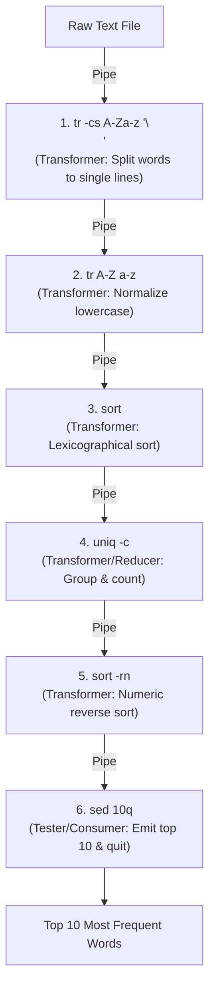

# Historical Case Study: "More Shell, Less Egg" (1986)

> How Doug McIlroy and Unix Pipes altered software engineering history against Donald Knuth's monolithic Pascal solution.

---

## 1. The Challenge

In 1986, Jon Bentley hosted a recurring column in the *Communications of the ACM* titled **"Programming Pearls"**. For a special edition, Bentley invited **Donald Knuth** (Turing Award winner, author of *The Art of Computer Programming*) to demonstrate his new concept of **Literate Programming** (weaving code and documentation together).

Bentley posed the following problem:
> **"Given a text file and an integer $k$, print the $k$ most common words in the file (and their counts) in decreasing order of frequency."**

---

## 2. Knuth's Solution: The Monolithic Masterpiece

Donald Knuth approached the problem with algorithmic perfection. He wrote an exhaustive **10-page Pascal program**:
- He designed an auxiliary **Patricia Trie** (a radix tree variant) to store word prefixes with minimal memory overhead.
- He implemented custom hashing and string-table management routines.
- He designed a custom insertion sort to maintain the top $k$ counts.

The code was mathematically optimal, impeccably documented, and an engineering triumph of monolithic algorithms.

---

## 3. McIlroy's Critique and the 6-Line Unix Pipeline

Jon Bentley invited **Doug McIlroy** (head of computing sciences research at Bell Labs and inventor of the **Unix Pipe**) to write a review of Knuth's program.

McIlroy admired Knuth's craftsmanship, but highlighted that Unix tools and the **Pipes and Filters architecture** made writing custom algorithms for common data flows obsolete:

```bash
tr -cs A-Za-z '\n' | tr A-Z a-z | sort | uniq -c | sort -rn | sed 10q
```

### Architectural Breakdown of McIlroy's Pipeline



1. `tr -cs A-Za-z '\n'`: **Transformer Filter**. Translates every non-alphabetic character into a newline, squashing consecutive delimiters. Each word is now on its own line.
2. `tr A-Z a-z`: **Transformer Filter**. Maps all uppercase ASCII characters to lowercase.
3. `sort`: **Transformer Filter**. Lexicographically sorts the words so duplicate occurrences become contiguous.
4. `uniq -c`: **Transformer / Reducer Filter**. Compares adjacent lines, collapses duplicates, and prefixes each line with its frequency count.
5. `sort -rn`: **Transformer Filter**. Sorts lines numerically in reverse order (highest frequency first).
6. `sed 10q`: **Tester / Consumer Filter**. Emits the first 10 lines and issues a stream termination signal (closing the pipe).

---

## 4. Key Lessons for Software Architecture

1. **Reusability through Generic Interfaces**: Filters work best when they operate on standardized, uniform data formats (in Unix: streams of bytes/lines; in modern enterprise: JSON/Protobuf/Avro messages).
2. **Separation of Concerns**: Each filter does exactly one thing well.
3. **Composability**: Adding, removing, or re-ordering a stage does not require rewriting any existing filter.
4. **Cost of Complexity**: Knuth's solution took days or weeks to design and debug; McIlroy's pipeline took minutes to compose and verify.
