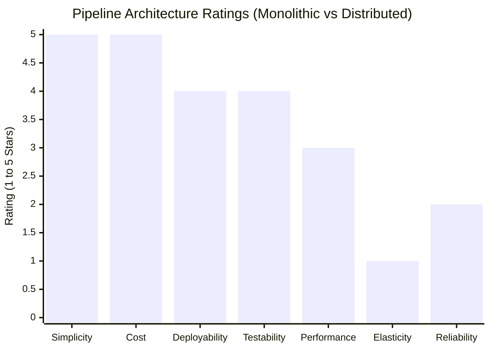

# Common Risks and Architectural Trade-Offs in Pipeline Architecture

> Based on Mark Richards & Neal Ford, *Fundamentals of Software Architecture* (O'Reilly).

---

## 1. Architectural Star Ratings

Richards and Ford evaluate the Pipeline Architecture across key system characteristics:

### Characteristic Breakdown

| Characteristic | Monolithic | Distributed | Rationale |
| :--- | :---: | :---: | :--- |
| **Simplicity** | ⭐⭐⭐⭐⭐ | ⭐⭐ | Monolithic pipes are in-process memory structures. Distributed systems require serialization, network retries, and broker cluster management. |
| **Cost** | ⭐⭐⭐⭐⭐ | ⭐⭐ | Monolithic requires minimal cloud resources. Distributed setups require running Kafka/RabbitMQ clusters and multiple microservice containers. |
| **Deployability** | ⭐⭐⭐⭐ | ⭐⭐⭐ | Monolithic deploys as a single unit. Distributed enables zero-downtime rolling filter updates, but requires schema contract compatibility. |
| **Testability** | ⭐⭐⭐⭐ | ⭐⭐⭐ | Individual filters are easily unit-tested as pure functions. Distributed testing requires spinning up mock brokers and testing async event timing. |
| **Performance** | ⭐⭐⭐ | ⭐⭐ | In-memory pipelines have zero network latency. Distributed pipelines accumulate 10-50ms latency on every pipe network hop. |
| **Elasticity** | ⭐ | ⭐⭐⭐⭐ | In a monolith, you cannot scale only the slow filter. In a distributed pipeline, you can autoscale a bottleneck filter to 50 pods independently. |
| **Reliability / Fault Tolerance** | ⭐⭐ | ⭐⭐⭐ | Monolithic crashes kill the whole pipeline. Distributed brokers persist messages and enable dead-letter retries, but introduce network partition risks. |

---

## 2. The Four Primary Architectural Risks

### Risk 1: Statefulness & Cross-Payload Dependencies (Anti-Pattern)
- **The Problem**: Developers frequently attempt to store running state across payload items inside a filter (e.g., maintaining an in-memory session cache).
- **The Consequence**: When scaling out filters across multiple threads or multiple distributed pods, payloads get routed across different instances, producing inconsistent or corrupted state.
- **Remediation**:
  1. Keep Producer, Tester, and Transformer filters strictly stateless.
  2. Confine any stateful aggregations exclusively to dedicated **MapReduce / Windowed Reducer** stages with partition keys.

### Risk 2: Latency Accumulation in Distributed Topologies
- **The Problem**: A pipeline with $N$ filters requires $N-1$ pipes. In a distributed microservice topology, every pipe transition involves:
  - Network I/O (TCP handshake, TLS encryption).
  - Serialization (JSON/Protobuf/Avro).
  - Message broker acknowledgment latency.
- **The Consequence**: If each hop incurs 20ms, an 8-stage pipeline incurs 140ms of baseline latency before executing any business logic.
- **Remediation**:
  - Co-locate sequential, tightly coupled filters into the same deployment unit.
  - Reserve distributed message queues only across major elasticity boundaries (e.g., between fast validation and slow, heavy AI/MapReduce processing).

### Risk 3: Partial Failures & Incomplete Pipeline Execution
- **The Problem**: A payload is successfully processed by Filter 1 and Filter 2, but Filter 3 crashes. Unlike a database transaction, there is no automatic rollback across separate pipes.
- **The Consequence**: Data is left in a partially mutated state across multiple upstream databases without reaching terminal reporting stores.
- **Remediation**:
  1. **Dead Letter Queues (DLQ)**: Divert failing payloads to a DLQ topic for inspection and replay.
  2. **Idempotent Consumers**: Ensure all filter operations are idempotent using unique transaction IDs (`txId`).
  3. **Saga Pattern**: When side effects mutate external databases early, emit compensating events if later stages fail.

### Risk 4: Backpressure Breakdown & Memory Exhaustion
- **The Problem**: Upstream Producer filters stream data at 50,000 items/second, while a downstream AI/MapReduce Transformer filter can only process 1,000 items/second.
- **The Consequence**: In-memory queues grow unbounded until `OutOfMemoryError` crashes the process. In message brokers, queue storage fills disks.
- **Remediation**:
  - Use bounded queues with backpressure (e.g., Reactive Streams, blocking queues, or pull-based polling).
