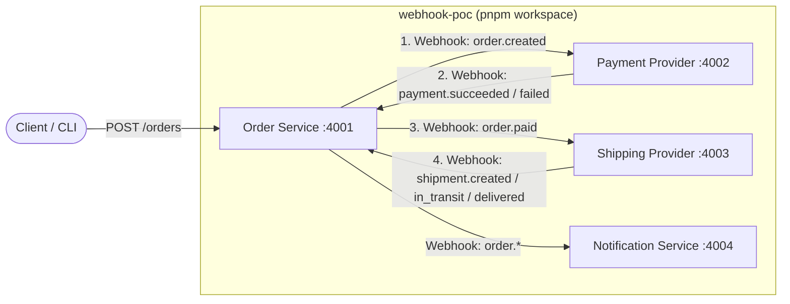
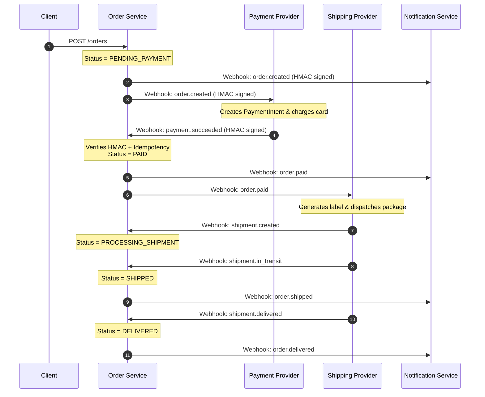

# Webhook Architecture POC — Order Lifecycle Flow

A **pnpm monorepo** demonstrating an end-to-end **Order Processing Flow** driven by **Webhooks** (`Order Service`, `Payment Provider`, `Shipping Provider`, and `Notification Service`). It includes a reusable webhook engine (`@webhook-poc/webhook-kit`) implementing **HMAC-SHA256 payload signing**, **replay attack protection**, **idempotent event consumption**, **exponential backoff retries**, and a **Dead Letter Queue (DLQ) with manual replay**.

---

## 1. The Problem & How Webhooks Solve It

### The Problem with Synchronous Calling & Polling
In distributed e-commerce systems, an order depends on multiple external or decoupled boundaries: payment gateways (e.g., Stripe, Adyen), 3PL logistics/shipping carriers (e.g., FedEx, DHL), and customer notification channels.

1. **Long-Running Operations & Timeouts:** Payment settlement (3D Secure, Pix, bank transfers) and physical package shipping take seconds, hours, or days. Holding an HTTP connection open is impossible.
2. **Polling Overhead (The "Are we there yet?" Problem):** If the Order Service polls the Payment Provider and Shipping Provider every few seconds to check status updates:
   - Most polling requests return no new changes (>95% wasted bandwidth and CPU).
   - Rate limits on third-party APIs are quickly exhausted.
   - Status updates suffer from polling interval latency.
3. **Tight Coupling Across Organizational Boundaries:** External SaaS providers cannot connect directly to your internal Kafka/RabbitMQ broker.

### How Webhooks ("Reverse APIs") Solve This
A **Webhook** is a user-defined HTTP callback triggered by a domain event. Instead of the consumer polling the producer, the consumer registers a target URL and event filter (`POST /webhooks/subscriptions`). Whenever state changes, the producer pushes a signed HTTP `POST` payload to the subscriber in real time.

| Dimension | Polling Approach | Message Broker (Kafka/RabbitMQ) | Webhook Approach |
| :--- | :--- | :--- | :--- |
| **Communication** | Pull (Consumer asks Producer) | Pub/Sub via shared broker | Push (Producer HTTP POSTs to Consumer) |
| **Cross-Boundary / 3rd Party** | Works, but high overhead | Rarely possible across company boundaries | **Ideal standard** (HTTP is universal) |
| **Latency** | Delayed by poll interval | Near real-time | **Near real-time** |
| **Resource Usage** | High wasted requests | Low (persistent connections) | **Strictly on-demand (event-driven)** |

---

## 2. How It Works (Architecture & Order Flow)

### System Architecture



### Sequence Diagram (Happy Path Order Lifecycle)



---

## 3. Core Webhook Engineering Patterns Implemented

All webhook mechanics live in [`packages/webhook-kit`](file:///home/ggm/Work/system-design/pocs/webhook-poc/packages/webhook-kit/src/index.ts):

1. **Cryptographic Signature (`HMAC-SHA256`) & Replay Protection** ([`signature.ts`](file:///home/ggm/Work/system-design/pocs/webhook-poc/packages/webhook-kit/src/signature.ts))
   - Since webhook endpoints are publicly reachable HTTP routes, receivers must verify that payloads genuinely came from the expected sender and were not modified in transit.
   - Each delivery includes `X-Webhook-Signature: t=<timestamp_ms>,v1=<hmac_sha256>`.
   - The HMAC is computed over `<timestamp_ms>.<raw_json_body>` using the subscription's shared secret and verified using constant-time comparison (`crypto.timingSafeEqual`).
   - If `|now - timestamp_ms| > 5 minutes`, the payload is rejected with `401 timestamp_expired` to prevent replay attacks.

2. **Idempotent Consumer / Inbox Pattern** ([`idempotency.ts`](file:///home/ggm/Work/system-design/pocs/webhook-poc/packages/webhook-kit/src/idempotency.ts))
   - Webhook dispatchers guarantee **at-least-once delivery**. If a receiver processes a webhook but its HTTP response times out, the sender will retry.
   - Every webhook carries a unique `X-Webhook-Id` (`event.id`). Receivers check `IdempotencyStore` before executing business logic and short-circuit duplicates with `200 OK ({ duplicate: true })`.

3. **Exponential Backoff Retries & Dead Letter Queue (DLQ)** ([`dispatcher.ts`](file:///home/ggm/Work/system-design/pocs/webhook-poc/packages/webhook-kit/src/dispatcher.ts))
   - When a subscriber responds with `5xx` or a network error occurs, `WebhookDispatcher` retries up to `maxAttempts` using exponential backoff (`baseDelayMs * 2^(attempt - 1)`).
   - If all attempts fail, the delivery transitions to `dead_letter` status and is stored in the **Dead Letter Queue**, where operators can inspect and replay it via `POST /webhooks/dlq/:deliveryId/replay` once the subscriber recovers.

---

## 4. Monorepo Structure

```text
webhook-poc/
├── pnpm-workspace.yaml
├── package.json
├── tsconfig.base.json
├── packages/
│   └── webhook-kit/             # Shared HMAC signer, verifier, IdempotencyStore, WebhookDispatcher
├── apps/
│   ├── order-service/           # Core Order state machine + outbound/inbound webhook endpoints
│   ├── payment-provider/        # Consumes order.created, emits payment.succeeded / payment.failed
│   ├── shipping-provider/       # Consumes order.paid, emits shipment.created / in_transit / delivered
│   └── notification-service/    # Consumes order.* webhooks to send customer email notifications
├── scripts/
│   └── demo.ts                  # Interactive multi-scenario CLI demonstration
└── tests/
    └── integration/
        └── order-webhook-flow.test.ts  # End-to-end integration test suite
```

---

## 5. Available Scripts (`package.json`)

| Script | Command | Description |
| :--- | :--- | :--- |
| `pnpm demo` / `npm run demo` | `node scripts/demo.ts` | Runs the interactive 4-scenario live demo flow |
| `pnpm test` / `npm test` | `node --test ...` | Runs all unit and integration tests |
| `pnpm test:unit` | `node --test packages/webhook-kit/src/signature.test.ts` | Runs `webhook-kit` unit tests (HMAC, replay protection, idempotency) |
| `pnpm test:integration` | `node --test tests/integration/order-webhook-flow.test.ts` | Runs the 6 end-to-end integration test scenarios |
| `pnpm start:orders` | `pnpm --filter @webhook-poc/order-service start` | Starts the Order Service on port `4001` |
| `pnpm start:payments` | `pnpm --filter @webhook-poc/payment-provider start` | Starts the Payment Provider on port `4002` |
| `pnpm start:shipping` | `pnpm --filter @webhook-poc/shipping-provider start` | Starts the Shipping Provider on port `4003` |
| `pnpm start:notifications` | `pnpm --filter @webhook-poc/notification-service start` | Starts the Notification Service on port `4004` |
| `pnpm dev` | `pnpm --parallel -r start` | Starts all 4 services in parallel |

---

## 6. Quick Start

### Run the Live Demo Flow
```bash
npm run demo
# or with pnpm:
pnpm demo
```
The demo script boots all 4 services, wires their webhook subscriptions, and walks through:
1. **Scenario 1 (Happy Path):** Full order lifecycle (`PENDING_PAYMENT` → `PAID` → `PROCESSING_SHIPMENT` → `SHIPPED` → `DELIVERED`).
2. **Scenario 2 (Transient Failure & Retry):** Injects HTTP `503` errors into `notification-service` and demonstrates automatic recovery via exponential backoff.
3. **Scenario 3 (Security):** Simulates a malicious attacker sending a forged `payment.succeeded` webhook and shows `401 Unauthorized (signature_mismatch)` rejection.
4. **Scenario 4 (Dead Letter Queue & Replay):** Simulates a prolonged outage that exhausts retries into the DLQ, restores service health, and replays the failed webhook via `POST /webhooks/dlq/:id/replay`.

### Run the Tests
```bash
npm test
# or with pnpm:
pnpm test
```
